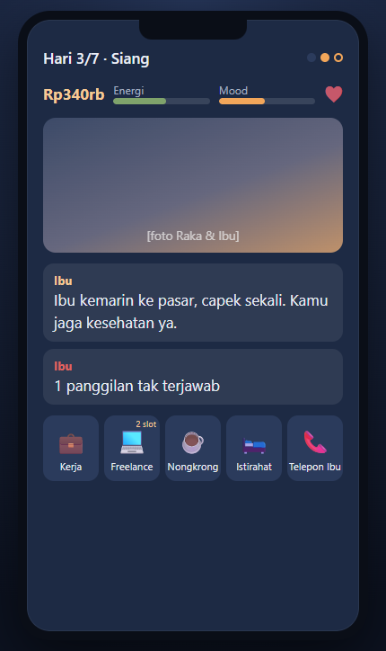

# Sinyal

> Gim naratif 2D tentang **pulang**. Untuk Gimersia Inspire 2026, tema: *Pulang*.



## Pitch

Raka, mahasiswa tingkat akhir yang merantau, sibuk mengumpulkan uang untuk mudik dan sering membalas ibunya dengan "nanti aja".
Selama 7 hari kamu mengatur waktu Raka: kerja, freelance, nongkrong, istirahat, atau mengangkat telepon ibu yang tidak menghasilkan uang.
Saat kabar ibu sakit datang, setiap pilihan sebelumnya menentukan apakah "pulang" Raka masih ada artinya.

## Status

**v0.1.0, prototipe untuk Checkpoint Progress 19 November 2026.** Bisa dimainkan dari awal sampai ending.

| Bagian | Status |
|---|---|
| Bab 1: 7 hari, 3 slot waktu per hari, 5 aksi, stat | ✅ jalan |
| Event telepon masuk (Angkat / Abaikan) | ✅ jalan |
| Minigame kerja (ketik kata, 12 detik, telepon bisa masuk di tengah) | ✅ jalan |
| Opsi "pulang lebih cepat" | ✅ jalan |
| Bab 2: pilih tiket & bawaan dengan dana darurat | ✅ jalan |
| Bab 3: peta perjalanan, 4 keputusan, garis detak jantung | ✅ jalan |
| 3 ending, tombol Ulangi, galeri "Lihat ending lain" | ✅ jalan |
| Tes otomatis logika (ketiga ending bisa dicapai) | ✅ 8/8 lulus |
| Teks cerita | 🟡 draf placeholder, menunggu Narrative Designer |
| Ilustrasi 2D & audio | 🔴 placeholder, menunggu 2D Artist & Sound Designer |
| Angka balancing | 🟡 awal, menunggu Game Designer |

## Cara main

- Setiap hari ada **3 slot waktu** (Pagi, Siang, Malam). Pilih satu aksi per slot.
- **Kerja** memberi uang dan memicu minigame mengetik kata. **Freelance** memberi uang lebih besar tapi memakan 2 slot.
- **Nongkrong** menaikkan mood dan kadang memberi info lowongan. **Istirahat** memulihkan energi.
- **Telepon Ibu** tidak menghasilkan uang, tapi mendekatkan Raka dan memberi petunjuk kondisi ibu.
- Kadang **HP berdering**. Angkat, dan bonus kerja hilang. Abaikan, dan ibu makin jauh.
- Tidak ada game over. Ada **3 ending** yang bergantung pada pilihanmu di Bab 1 dan Bab 3.

## Cara menjalankan

Tidak perlu install apa pun.

1. Buka `src/index.html` di browser (Chrome, Edge, atau Firefox).
2. Klik **Mulai**.

Parameter URL untuk tim:

| Parameter | Fungsi |
|---|---|
| `?debug=1` | Menampilkan stat tersembunyi: kesehatan ibu, info, skor Bab 3, prediksi ending |
| `?scene=day` | Lompat langsung ke layar tertentu, berguna untuk screenshot |

Nilai `scene` yang tersedia: `title`, `day`, `call`, `minigame`, `bab2`, `bab3`, `ending1`, `ending2`, `ending3`.

Contoh: `src/index.html?scene=minigame&debug=1`

## Tes & build

```bash
# tes logika (butuh Node.js 18+)
npm test

# build web untuk itch.io → dist/sinyal-web-v<versi>.zip (butuh Python 3)
npm run build
```

Tanpa Python, zip saja **isi** folder `src/` sehingga `index.html` ada di root zip.

## Struktur folder

```
sinyal-game/
├─ src/                  ← gim (ini yang di-upload ke itch.io)
│  ├─ index.html
│  ├─ css/style.css      ← tampilan (token warna di :root)
│  ├─ js/config.js       ← SEMUA angka balancing (Game Designer)
│  ├─ js/data.js         ← SEMUA teks cerita (Narrative Designer)
│  ├─ js/logic.js        ← aturan gim, tanpa UI
│  ├─ js/minigame.js     ← minigame kerja
│  ├─ js/audio.js        ← SFX sementara (Web Audio)
│  ├─ js/main.js         ← alur layar & UI
│  └─ assets/            ← art/ & audio/ dari tim
├─ tests/logic.test.js   ← simulasi gaya bermain → cek ketiga ending
├─ tools/build_web.py    ← bikin zip untuk itch.io
└─ docs/                 ← arsitektur, panduan itch.io, kredit, screenshot
```

Penjelasan lengkap ada di [docs/ARCHITECTURE.md](docs/ARCHITECTURE.md).

## Langkah berikutnya

Batas submission: **Minggu, 29 November 2026, 23.59 WIB**.

- [ ] Ganti teks draf di `data.js` dengan naskah final dari Narrative Designer.
- [ ] Sesuaikan angka di `config.js` dengan tabel mekanik dari Game Designer.
- [ ] Pasang ilustrasi dan audio buatan tim. AI tidak boleh dipakai untuk aset visual.
- [ ] Terapkan wireframe dan palet warna dari UI/UX Designer.
- [ ] Tambah variasi minigame, misalnya klik target bergerak atau menyusun berkas.
- [ ] Playtest dan balancing ending.
- [ ] Rekam video gameplay 60 detik sampai 2 menit, lalu ambil minimal 3 screenshot final.
- [ ] Isi [docs/CREDITS.md](docs/CREDITS.md) dengan semua aset pihak ketiga untuk di-declare.

## Tim

| Peran | Nama |
|---|---|
| Game Designer | Nofrendy |
| Game Programmer | Eko Muhammad Rizki |
| Narrative Designer | Asep Sulaeman |
| 2D Artist & Sound Designer | Diki |
| Producer | Dena Maulana |
